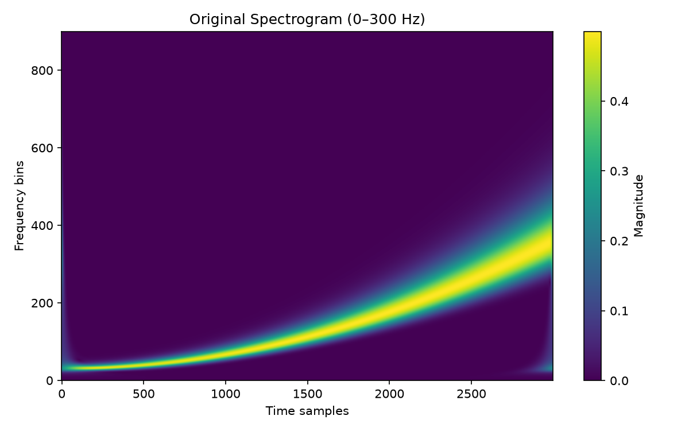
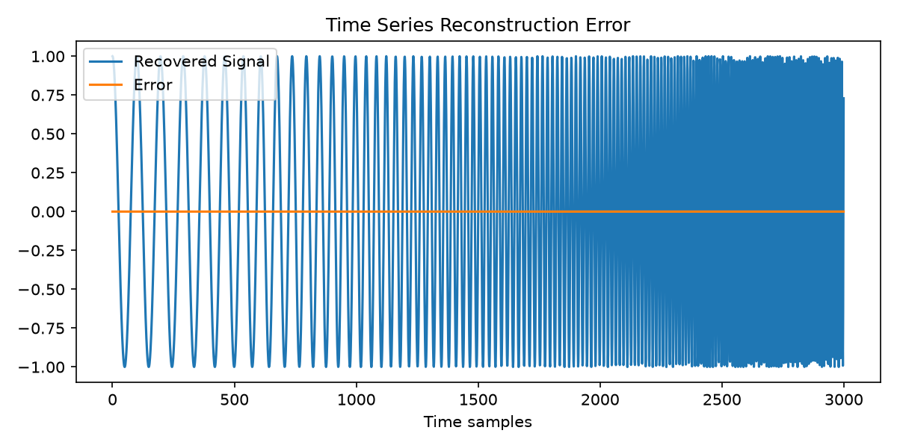

# S-Transform for Python

This repository provides a NumPy/SciPy implementation of the discrete
Stockwell (S) transform for one-dimensional signals. The installable package
is named `s-transform` and exposes the public API from `s_transform`.

## Install

Install the runtime package from a checkout with:

```bash
python -m pip install .
```

For local development, including tests, linting, type checking, and optional
plotting support:

```bash
python -m pip install -e ".[dev,plot]"
```

The core package depends only on NumPy and SciPy. Matplotlib is available in
the optional `plot` extra.

## Quick start

```python
import numpy as np
from scipy.signal import chirp

from s_transform import s_transform

sample_rate = 1_000.0
duration = 3.0
time = np.arange(0.0, duration, 1.0 / sample_rate)
signal = chirp(time, f0=10.0, t1=duration, f1=120.0, method="quadratic")

st = s_transform(signal, sample_rate=sample_rate)

# Numerical values are owned by st.data. The axes are physical units:
# frequencies in Hz and times in seconds.
print(st.data.shape)
print(st.frequencies)
print(st.times)
```

The default transform uses every FFT bin from zero through Nyquist. The
selected FFT bins are available as `st.frequency_indices`, and signed indices
are available as `st.signed_frequency_indices` when a signed range is used.
The metadata properties `duration`, `time_step`, `frequency_resolution`,
`frequency_range`, and `time_range` expose the physical axes without deriving
them from array shapes. `st.is_downsampled` and `st.is_upsampled` describe
whether the time axis has fewer or more columns than the input signal.

To inspect the magnitude, use the explicit numerical array:

```python
magnitude = np.abs(st.data)
```

For a display in decibels, use a display floor appropriate to the application:

```python
floor = np.finfo(float).tiny
magnitude_db = 20.0 * np.log10(np.maximum(magnitude, floor))
```

## Optional plotting

Matplotlib is not required for core transforms or tests. Install the plotting
extra, then plot the physical axes directly:

```bash
python -m pip install ".[plot]"
```

The repository's `test.py` plotting demo uses this same optional extra.

```python
import matplotlib.pyplot as plt

image = plt.pcolormesh(
    st.times,
    st.frequencies,
    np.abs(st.data),
    shading="auto",
)
plt.xlabel("Time (s)")
plt.ylabel("Frequency (Hz)")
plt.title("S-transform magnitude")
plt.colorbar(image, label="Magnitude")
plt.show()
```

## Signed frequencies and inversion

For complex signals with negative-frequency content, request the complete
signed range explicitly:

```python
from s_transform import inverse_s_transform

complex_signal = signal + 0.25j * np.sin(2.0 * np.pi * 80.0 * time)
complex_st = s_transform(
    complex_signal,
    sample_rate=sample_rate,
    frequency_range=(-sample_rate / 2.0, sample_rate / 2.0),
)
complex_recovered, _ = inverse_s_transform(complex_st)
np.testing.assert_allclose(complex_recovered, complex_signal, atol=1e-10)
```

For a real-valued signal, the full nonnegative-frequency transform can be
reconstructed without a manual magnitude correction:

```python
recovered, recovered_spectrum = inverse_s_transform(st)
np.testing.assert_allclose(recovered.real, signal, atol=1e-10)
```

For a plain ndarray, provide the inversion metadata explicitly. A plain array
without frequency metadata is interpreted as contiguous FFT bins beginning at
zero, and `original_length` is required:

```python
recovered, recovered_spectrum = inverse_s_transform(
    np.asarray(st),
    **st.inverse_kwargs,
)
```

`STransform` is a frozen metadata wrapper. Its numerical values live in
`st.data`, while `np.asarray(st)` provides a convenient array conversion.
Constructing a new wrapper is required when using a derived array with new
shape or frequency rows; pass `frequency_indices` and `original_length`
explicitly when inverting such an array.

## Resampling the time axis

`output_length=M` resamples the transform's time axis to `M` columns after the
transform is computed. It accepts both even and odd positive lengths, and may
be smaller or larger than the input length. Upsampling changes the sampling
grid of the transform; it does not add information to the original signal.
Reducing the number of columns is not lossless. To prevent accidental
multi-gigabyte allocations, `s_transform` limits the output to 20 million
complex elements by default; pass `max_output_elements=None` only when a
larger transform is intentional.

## Performance benchmark

Install the optional benchmark dependency and compare the batched transform
with the previous row-wise algorithm:

```bash
python -m pip install ".[benchmark]"
python benchmarks/benchmark_s_transform.py --repeats 5
```

The script reports median runtime, speedup, and sampled peak process memory for
dense real, full signed complex, and resampled transforms. Results depend on
the machine and are not used as CI timing thresholds.

## Migration from the pre-package API

This is a clean-break `0.1.0` release:

- `from s import ...` becomes `from s_transform import ...`.
- `STransformArray` becomes the frozen `STransform` wrapper.
- Use `st.data` for numerical values; use `np.asarray(st)` for conversion.
- `freq_range` becomes `frequency_range`.
- `freq_step` becomes `frequency_step`.
- `downsample` becomes `output_length` and supports both downsampling and
  upsampling.
- `low_freq` becomes `low_frequency_index`.

## References

- R. G. Stockwell, L. Mansinha, and L. Lowe, “Localization of the Complex
  Spectrum: The S Transform,” *IEEE Transactions on Signal Processing*, 1996.
- R. G. Stockwell, *S-transform analysis of gravity wave activity from a small
  scale network of airglow imagers*, PhD thesis, University of Western Ontario,
  1999.





## Reference material

The original thesis copy is included for reference:


